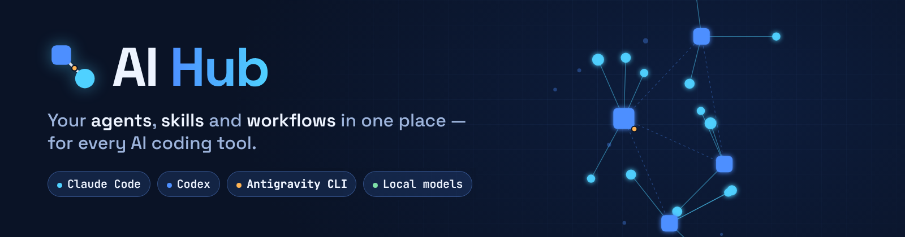
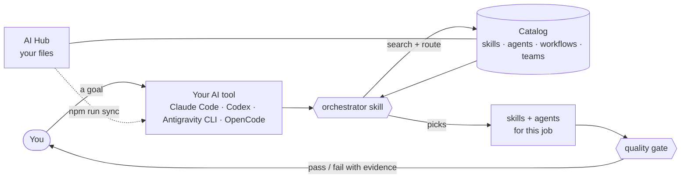

<div align="center">

<picture>
  <source media="(prefers-color-scheme: dark)" srcset="docs/assets/banner-dark.png">
  <source media="(prefers-color-scheme: light)" srcset="docs/assets/banner-light.png">
  
</picture>

<br>

[](https://github.com/Fili999/ai-hub/actions/workflows/test.yml)
[](LICENSE)
[](https://nodejs.org)
[](package.json)
[](#download)

[**⬇ Download**](#download) &nbsp;·&nbsp; [Quick start](#quick-start) &nbsp;·&nbsp; [Features](#features) &nbsp;·&nbsp; [Works with](#works-with) &nbsp;·&nbsp; [Docs](#documentation)

</div>

---

## What is AI Hub?

AI coding tools are only as good as the instructions you give them. **AI Hub** is a small, local, open-source toolbox that keeps those instructions — **skills** (procedures), **agents** (roles), **workflows** (processes) and **teams** — in one place that *you* own, and installs them into the AI tools you use:

- 🧭 **One catalog, any tool.** Write a skill or an agent once; the hub installs it into Claude Code, Codex, Antigravity CLI or a local model (through OpenCode), converting agents to each tool's format.
- 🎛️ **An orchestrator, optional.** Say what you want; the starter `orchestrator` skill picks the right skills and agents from your catalog, checks tools and risks, and closes with a quality gate. Keep it, change it, or write your own.
- 🔒 **Safe by default.** Skills from GitHub are scanned (optional NVIDIA SkillSpector), approved against the exact hash of their files, and never edited by hand. Commands are never free text.
- 🧩 **Yours to shape.** Your own roles, agents, skills, teams, categories, models, languages and security level — all configurable, from a guided setup or in the interface.

> **Local and private.** Everything runs on your computer. No account, no cloud service, no telemetry. The web interface listens on `127.0.0.1` only.

## Download

Pick your system and install. **Node.js is included**: there is nothing else to install.

| | **Windows** | **macOS** |
|---|---|---|
| **Download** | [**AI-Hub-Setup.exe**](https://github.com/Fili999/ai-hub/releases/latest/download/AI-Hub-Setup.exe) | [**AI-Hub-mac-apple-silicon.zip**](https://github.com/Fili999/ai-hub/releases/latest/download/AI-Hub-mac-apple-silicon.zip) (M1 or later) · [**AI-Hub-mac-intel.zip**](https://github.com/Fili999/ai-hub/releases/latest/download/AI-Hub-mac-intel.zip) |
| **Operating system** | Windows 10 or 11, 64-bit | macOS 13.5 (Ventura) or newer |
| **Required** | Nothing | Nothing |
| **Disk space** | about 200 MB | about 200 MB |
| **Also needed** | A modern web browser | A modern web browser |
| **Optional** | [Git](https://git-scm.com) (install skills from GitHub, sync between computers) · [winget](https://learn.microsoft.com/windows/package-manager/winget/) (automatic installs) · an AI tool | [Git](https://git-scm.com) (macOS offers the Command Line Tools) · [Homebrew](https://brew.sh) (automatic installs) · an AI tool |
| **Start** | run the installer, then open **AI Hub** from the Start menu or the desktop | unzip, drag **AI Hub** to Applications, double-click it |
| **First-run note** | The app is not code-signed yet, so SmartScreen may warn: *More info → Run anyway* | Not code-signed yet: the first time, right-click → *Open* (macOS 15: System Settings → Privacy & Security → *Open Anyway*) |

Your hub lives in a normal folder, **`AI Hub`** in your user folder, so your skills, agents and memory are easy to find, back up or sync with GitHub. Closing the browser page stops the hub by itself after a few minutes.

**Prefer the classic zip?** [ai-hub-windows.zip](https://github.com/Fili999/ai-hub/releases/latest/download/ai-hub-windows.zip) and [ai-hub-macos.zip](https://github.com/Fili999/ai-hub/releases/latest/download/ai-hub-macos.zip) need [Node.js](https://nodejs.org) 18+ (offered automatically) and `START-HERE.txt` (three steps). Checksums are in `SHA256SUMS.txt` on the [release page](https://github.com/Fili999/ai-hub/releases/latest). **Linux** and developers: use the source below (the code is tested on Linux, Windows and macOS in CI).

```bash
git clone https://github.com/Fili999/ai-hub.git
cd ai-hub
./bootstrap.sh        # Windows: .\bootstrap.cmd
```

> You need at least one AI tool to *use* the skills (Claude Code, Codex, Antigravity CLI or OpenCode), but not to browse the catalog or the interface.

## Quick start

1. **Run the setup** (`bootstrap` above, or `npm run setup`). It asks your **language**, which **AI tools** you use, the **security level**, and installs the hub's skills and agents into your tools. Every install command is shown before it runs, and nothing is installed without your yes.
2. **Open the interface:** `npm start` (or double-click `start.cmd` / `start.command`). On first launch it opens the *Welcome* page, so you can also do step 1 there.
3. **Use it.** In your AI tool just describe what you want; the `orchestrator` skill takes it from there. Create your own skills and agents in the **Create** tab, install more from a GitHub link in **Install**, group them into **Teams**.

Almost everything the interface does is also available from the terminal: `npm run setup`, `search`, `route`, `add`, `link`, `sync`, `doctor`, `team`, `memory`, `evaluate`… (`npm run` lists them; the guide explains each).

## Features

| | |
|---|---|
| 🗂️ **Catalog** | Skills, agents, workflows and teams in plain Markdown files, with a generated index, categories, search, risk rating and a graph of how they connect. |
| 🧠 **Routing** | `npm run route "what you want"` proposes mode (direct, workflow or general method), a workflow, the skills for each capability and a team. Deterministic, no model call. |
| 🔁 **Multi-tool sync** | One `npm run sync` installs into every tool you enabled. Skills go where each tool reads them (the open Agent Skills folder `~/.agents/skills` is shared by Codex and OpenCode; Antigravity CLI reads `~/.gemini/config/skills`); agents are converted. Only what the hub placed is ever replaced or removed. |
| 🎚️ **Models and effort per tool** | Pick a portable level (`model-tier: high \| balanced \| fast`, `effort-tier`) or an exact model for each tool — Codex models and effort, Antigravity models (`pro` / `flash`), a local model such as `ollama/qwen3:30b`. Lists live in `providers.json`. |
| ✨ **Guided creation** | A five-step wizard writes well-formed skills and agents (never overwrites a file), with live preview and checks. |
| 🛡️ **Safe installs** | Preview before installing, optional [NVIDIA SkillSpector](https://github.com/NVIDIA/SkillSpector) scan (block / warn / off), exact-hash approvals, no symlink following, no code executed while downloading. |
| 👥 **Teams** | Group agents and skills by domain and role (research, development, security…), see a graph and flow per team, get suggestions when you build one. |
| 🧾 **Memory, evaluation, usage** *(optional)* | Notes in `memory/` (open them with Obsidian), per-job scores and weak points, usage and token estimates — all local and switchable. |
| 🌍 **Languages** | English by default; add a language by adding one JSON file. |
| 🖥️ **Local interface** | Graph (3D/2D), flow, catalog, teams, create, files, install, guide, system, settings; light and dark themes. |
| 🔄 **Sync between computers** *(optional)* | Keep your hub in your own GitHub repository and sync Mac, Windows and Linux with a safe fast-forward-only workflow. Off by default. |

## Works with

| AI tool | Skills folder | Agents | Instructions file | Models / effort |
|---|---|---|---|---|
| **Claude Code** | `~/.claude/skills` | `~/.claude/agents` (Markdown) | `CLAUDE.md` | `model`, `effort` or tiers |
| **Codex** (OpenAI) | `~/.agents/skills` | `~/.codex/agents` (TOML) | `AGENTS.md` | `codex-model`, `codex-effort` or tiers |
| **Antigravity CLI** | `~/.gemini/config/skills` | `~/.gemini/config/agents` (Markdown) | `GEMINI.md` | `antigravity-model` or tiers |
| **OpenCode** — local models via Ollama, LM Studio… | `~/.agents/skills` | `~/.config/opencode/agents` (Markdown) | `AGENTS.md` | `opencode-model`, `opencode-effort` |

Folders can be moved with `CLAUDE_CONFIG_DIR` / `CODEX_HOME` or by editing [`providers.json`](providers.json). Model names change often and depend on your account, so the lists are yours to edit — or choose *"same as the session"*. Want another tool? See [Adding an AI tool](CONTRIBUTING.md#adding-an-ai-tool).

## How it works



You keep your skills and agents as plain files in the hub (`skills/own`, `agents/own`). `sync` installs them into your tools; the catalog index lets the orchestrator find the right ones *without* reading hundreds of files, which keeps token use low.

## Starter content

A small, optional starting point — keep it, edit it, delete it, or write your own.

| Skills (`skills/own`) | |
|---|---|
| `orchestrator` | Lead skill: intake, routing, execution, quality gate |
| `hub-manager` | Install, update, assign and sync skills and agents |
| `task-intake` · `acceptance-criteria` | Clarify the goal; write checkable success criteria |
| `quality-gate` · `self-critique` | Verify against criteria with evidence; honest per-point review |
| `structured-handoff` · `decision-record` | Pass work between agents; record decisions |
| `source-verification` · `memory` | Check sources; remember what is worth remembering |

| Agents (`agents/own`) | |
|---|---|
| `planner` | Turns a vague request into a plan with acceptance criteria (read-only) |
| `researcher` | Finds and verifies information from dated sources (no edits) |
| `implementer` | Makes a focused change with tests and a short report |
| `reviewer` | Independent pass / fail / blocked check with evidence (no edits) |

Workflow: `code-change` (intake → criteria → change → verification → close). Teams start empty: create yours in the **Teams** tab.

## Security

AI Hub installs *instructions that AI tools will follow*, so it is careful by design:

- **Untrusted by default:** third-party skills are data, never instructions to the hub.
- **Preview → scan → approve → activate.** Approvals are bound to the SHA-256 of the exact bytes; a changed file is not activated.
- **No free-text commands.** Programs come from `dependencies.json` as `{manager, package}`; the code builds the command and shows it before running.
- **Fail-closed** scanning in the default policy; no option to skip the scan, only to change the policy in Settings.
- **Local only:** the interface binds to `127.0.0.1`, checks `Host` and `Origin`, and needs a per-session token.
- **No irreversible action without a yes:** push, install from a link, deletion.

Details: [docs/security.md](docs/security.md) · report a vulnerability privately: [SECURITY.md](SECURITY.md).

## Configuration

Everything is a readable file; the interface and the guided setup just edit them.

| File | What it configures |
|---|---|
| [`settings.json`](docs/guide.md) | Language, AI tools, security policy, quality, memory, usage, sync between computers |
| [`providers.json`](providers.json) | Folders, agent format, models and effort levels of each AI tool |
| [`dependencies.json`](dependencies.json) | Programs the hub may install (with `winget`, `brew`, `npm`, `uv`) |
| [`hub.config.json`](hub.config.json) | Categories and their keywords |
| `registry.json` · `teams.json` | Your links between agents and skills · your teams |
| `i18n/*.json` | Messages in each language |

## Documentation

[Guide](GUIDE.md) (generated, always current) · [Architecture](docs/architecture.md) · [Contracts](docs/contracts.md) · [Naming](docs/naming.md) · [Security](docs/security.md).

## Contributing

Fixes, tests, new AI-tool adapters and starter content are welcome — see [CONTRIBUTING.md](CONTRIBUTING.md) and the [Code of Conduct](CODE_OF_CONDUCT.md). If you use an AI assistant to contribute, [AGENTS.md](AGENTS.md) tells it the rules. Run `npm test` (no install step: there are no dependencies).

## License

[MIT](LICENSE). Third-party skills you install keep their own licenses. [NVIDIA SkillSpector](https://github.com/NVIDIA/SkillSpector) (Apache-2.0) is an optional separate program, not included. The Agent Skills format is an open standard ([agentskills.io](https://agentskills.io)). Space Grotesk and JetBrains Mono (SIL OFL) are bundled with the interface.
